# KOReader-first Nook: User guide

## About this guide

This guide shows how to use everything KOReader-first Nook adds to your Nook GlowLight 4 Plus: Wi-Fi and Bluetooth from inside KOReader, the Nook's page buttons and frontlight, the reading fonts, the power-off timer, and the Home button that opens KOReader.

It assumes everything is already installed. To install, update or remove KOReader-first Nook, see the README on the project's GitHub page (github.com/apastuszak/nook-koreader-first).

### Finding your way around KOReader's menus

Most of what follows lives in KOReader's **top menu**. With a book open, tap near the top of the screen. In the file browser, tap the top bar.

The top menu has a row of tabs. With a book open, from left to right:

- **Navigation** (the bookmark): table of contents and bookmarks
- **Typesetting** (the page of lines): fonts and page layout
- **Settings** (the gear): frontlight, network, screen and device settings
- **Tools** (the screwdriver and wrench)
- **Search** (the magnifier)
- **File browser** (the cabinet)
- **Main menu** (the three lines): history, help, and Exit or Restart KOReader

The file browser's top menu has fewer tabs, but the same **Settings**, **Tools**, **Search** and **Main menu** tabs.

KOReader also has a **bottom menu**: with a book open, tap near the bottom of the screen. It holds font size, margins, contrast and similar page settings.

## The Home button

If you chose **KOReader Home** as your default Home app when installing, the Nook starts in KOReader, and pressing **Home** always brings you back to KOReader.

The Nook's Home button is touch-sensitive, not a real button. **Touch it for about a second**: a very quick tap may not register.

### Restart KOReader

With KOReader Home as the default, KOReader's **Exit** item becomes **Restart KOReader** (in the **Main menu** tab). It closes KOReader and opens it again straight away. Use it after adding fonts, plugins or patches, which KOReader only loads when it starts.

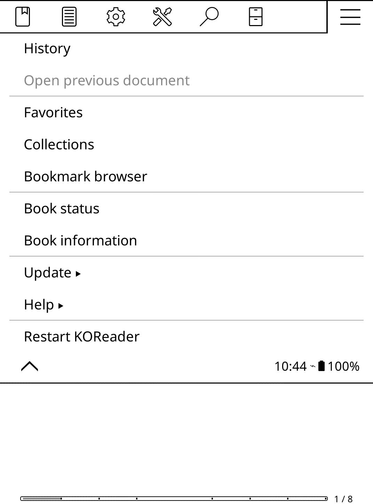

### The recovery screen

The recovery screen is your way out of KOReader, for example to reach the Nook's own home screen, the B&N store or Android settings.

**To open it, press Home 3 times, about 2 seconds apart**, touching the button for about a second each time. Quick taps do not work: the button only registers a press 1 to 2 seconds after the last one, so fast taps count as one. You can also open it from the **KOReader Home** icon in any other launcher's app list.

It also opens by itself if KOReader closes 3 times within 30 seconds (for example if it keeps crashing), so the Nook never gets stuck. **Restart KOReader** counts too: using it 3 times within 30 seconds opens the recovery screen.

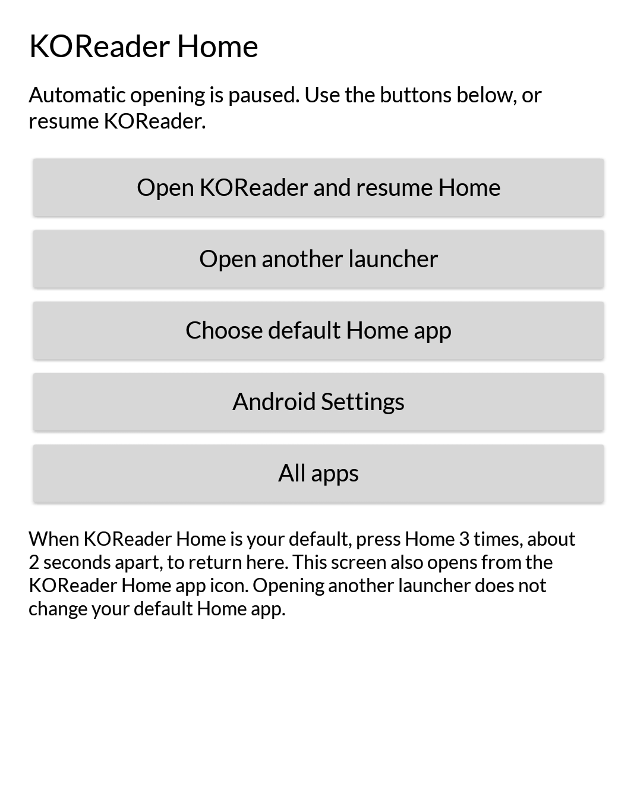

- **Open KOReader and resume Home**: back to normal. KOReader opens, and Home opens KOReader again.
- **Open another launcher**: opens the Nook's own home screen or another launcher you have installed. Your default Home app does not change.
- **Choose default Home app**: Android's settings screen for the default Home app (choose **Home app** there). Use it to stop using KOReader Home.
- **Android Settings** and **All apps**.

While the recovery screen is active ("Automatic opening is paused"), Home keeps showing it, even after a restart, until you choose **Open KOReader and resume Home**.

## Wi-Fi

Everything about Wi-Fi is in the **Settings** tab, under **Network**.

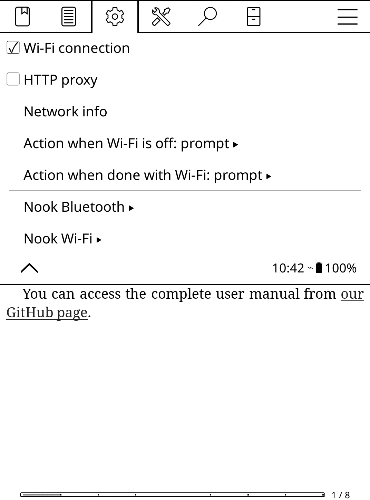

**Wi-Fi connection** is KOReader's own switch. It now turns Wi-Fi on and off directly, instead of sending you to Android's settings. Anything in KOReader that needs the network, such as syncing, OPDS catalogues or news downloads, can turn Wi-Fi on by itself too, depending on **Action when Wi-Fi is off**.

### The Nook Wi-Fi menu

**Nook Wi-Fi** has everything else:

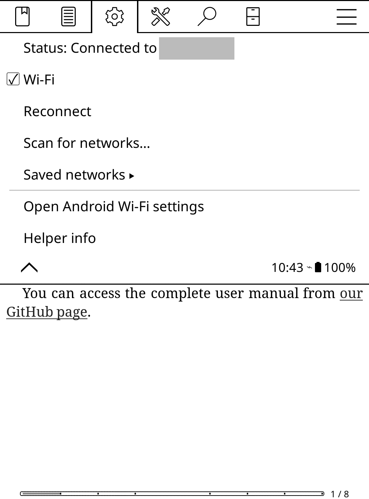

- **Status**: the network you are connected to. Tap it for details: signal, IP address and link speed.
- **Wi-Fi**: on or off. The Nook reports success only once Wi-Fi is really on and connected, or really off.
- **Reconnect**: connects to the best saved network, turning Wi-Fi on first if needed.
- **Scan for networks…**: lists the networks around you. Tap one to join it.
- **Saved networks**: switch to another network you have used before.
- **Open Android Wi-Fi settings**: Android's own Wi-Fi screen, for anything the menu cannot do.
- **Helper info**: the version numbers, useful when asking for help.

### Joining a new network

1. Tap **Scan for networks…**
2. Tap the network you want.
   - A network you have joined before connects straight away.
   - An open network joins without a password.
   - A secured network asks for its password.
3. Wait for "Connected to …".

If the password is wrong, the Nook says so and forgets the network again, so you can simply try once more.

Not supported: WPA3-only and Enterprise networks (the kind with a user name, often at work or school), WEP, and hidden networks. Use **Open Android Wi-Fi settings** for those.

**Tip:** the **Toggle Wi-Fi** gesture (Settings, Taps and gestures) turns Wi-Fi on and off without opening any menu.

## Bluetooth page turners

**Nook Bluetooth**, also under **Settings**, **Network**, is for Bluetooth page-turner remotes. KOReader sees a remote as a keyboard, so its buttons turn pages. Headphones and other audio devices are not supported.

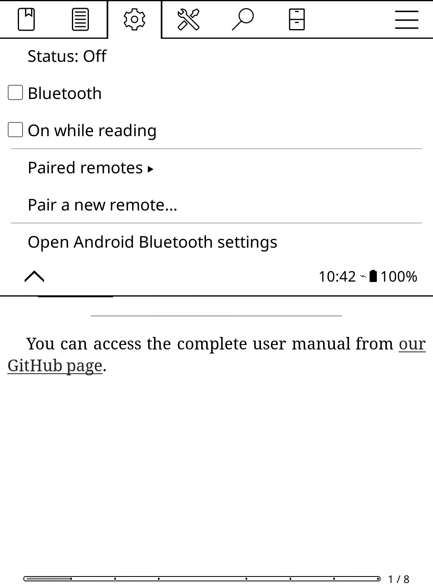

- **Status**: whether Bluetooth is on, and which remote is connected. Tap it to refresh.
- **Bluetooth**: on or off.
- **On while reading**: Bluetooth turns on by itself when you open a book, and off again when you close it or when the Nook goes to sleep. It saves battery without you having to think about it.
- **Paired remotes**: the remotes you have paired. To forget one, hold its name.
- **Pair a new remote…**: see below.
- **Open Android Bluetooth settings**: Android's own Bluetooth screen (not the Nook's, which cannot pair remotes).

### Pairing a remote

1. Put the remote in pairing mode (see its instructions; usually you hold a button until a light flashes).
2. Tap **Pair a new remote…** and wait for the list. Likely remotes are at the top.
3. Tap your remote. After a few seconds the Nook says it is connected.

Some remotes ask for a PIN; Android then shows its own pairing window on top of KOReader.

### When a remote does not respond

After Bluetooth turns on, most remotes reconnect only when you **press one of their buttons**. That first press may not turn a page. For a minute after you turn Bluetooth on, the Nook tells you when a remote connects.

**Tip:** the **Toggle Bluetooth** action can be put on a gesture, or on a key.

## Page buttons and frontlight

### Page buttons

The Nook's four page buttons turn pages in KOReader: the **upper** button on either side goes **forward**, the **lower** one goes **back**.

### Frontlight

KOReader has its own frontlight controls, with brightness and warmth sliders. Open them from the **Settings** tab, **Frontlight** (the first item), or with a gesture you assign to the frontlight.

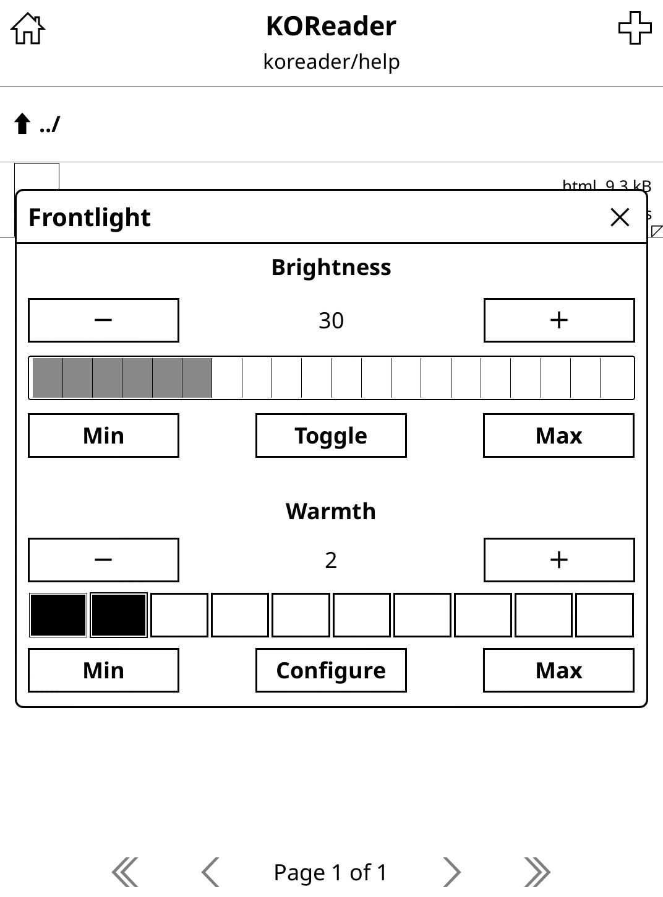

- **Brightness**: tap a step on the bar, or use **−** and **+**. **Toggle** turns the light off and on.
- **Warmth**: the same for the colour of the light, from cool to warm.
- **Min** and **Max** jump to either end.

Without KOReader-first Nook's setup, KOReader only offers Android's small light dialog, shown here for comparison:

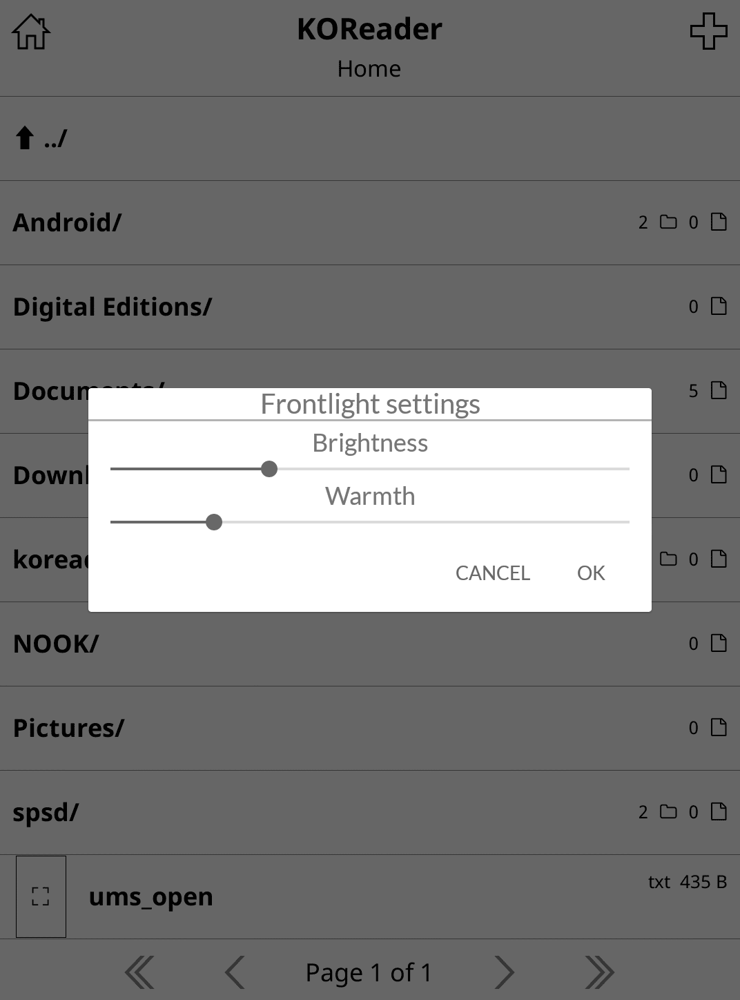

If brightness or warmth do nothing, see "Something does not work" at the end of this guide.

## Reading fonts

Four font families come with KOReader-first Nook, each with several weights and real italics:

- **Atkinson Hyperlegible Next**: a sans serif from the Braille Institute, with letters designed to be easy to tell apart (for example I, l and 1).
- **Bitter**: a slab serif designed for reading on screens.
- **Lexend** (listed as **Lexend-aalt**): a sans serif designed to make reading easier; this version has a simple, handwriting-style "a".
- **Literata**: a serif made for reading books on screens.

### Choosing a font

1. Open a book.
2. Tap the top of the screen and choose the **Typesetting** tab (the second one).
3. Tap **Font**. Each font's name is shown in that font.
4. Tap a font to use it for this book.

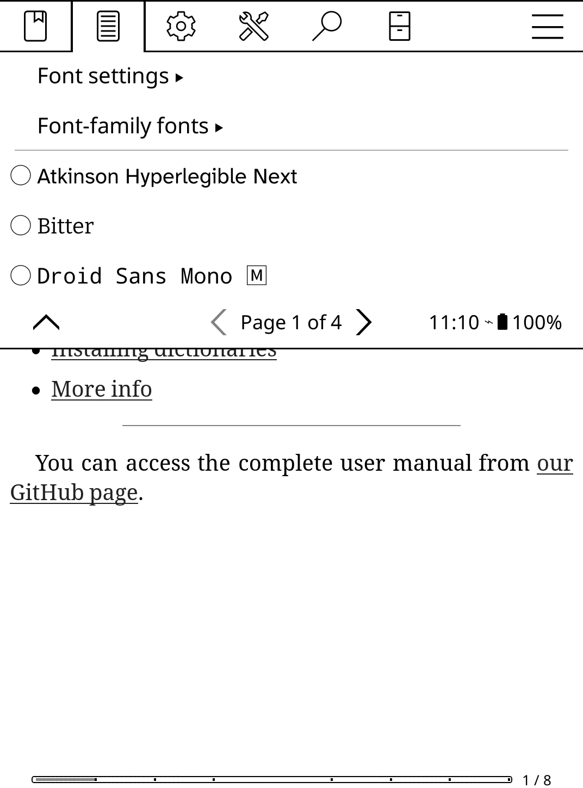

The list is in alphabetical order and has several pages. Lexend-aalt and Literata are on the second page (tap the arrow at the bottom of the menu):

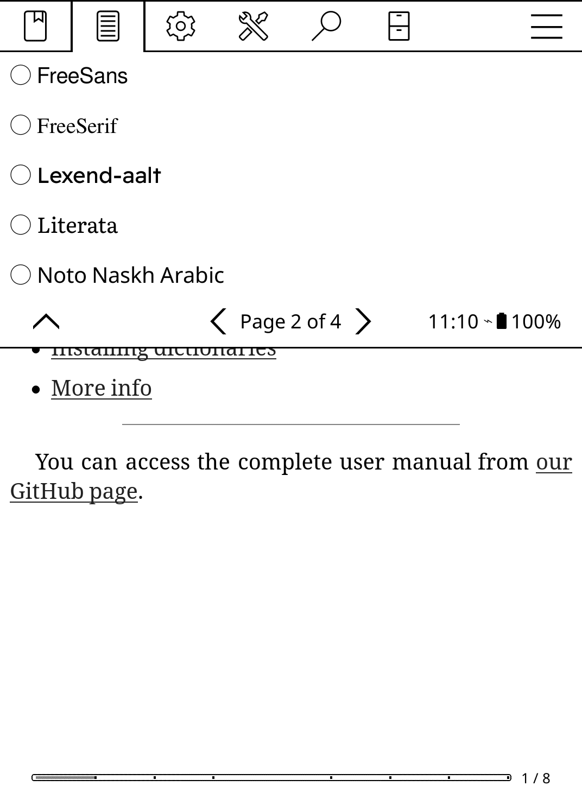

**To make a font your default for new books**, hold its name, and choose to use it as the **default font (★)**.

**Bolder or lighter text:** in the bottom menu (tap the bottom of the screen), the contrast tab has **Font Weight**. These fonts come in many weights, so KOReader can use a real lighter or bolder version of the font.

Italic text in a book uses the font's real italics, not a slanted copy of the normal letters.

## Nook power off after sleeping

The Nook can switch itself off after it has been asleep for a while. A switched-off Nook uses no battery, but starting it again takes a long press of the power button and a full start-up.

Find it in the **Settings** tab, under **Device** (it is the last item):

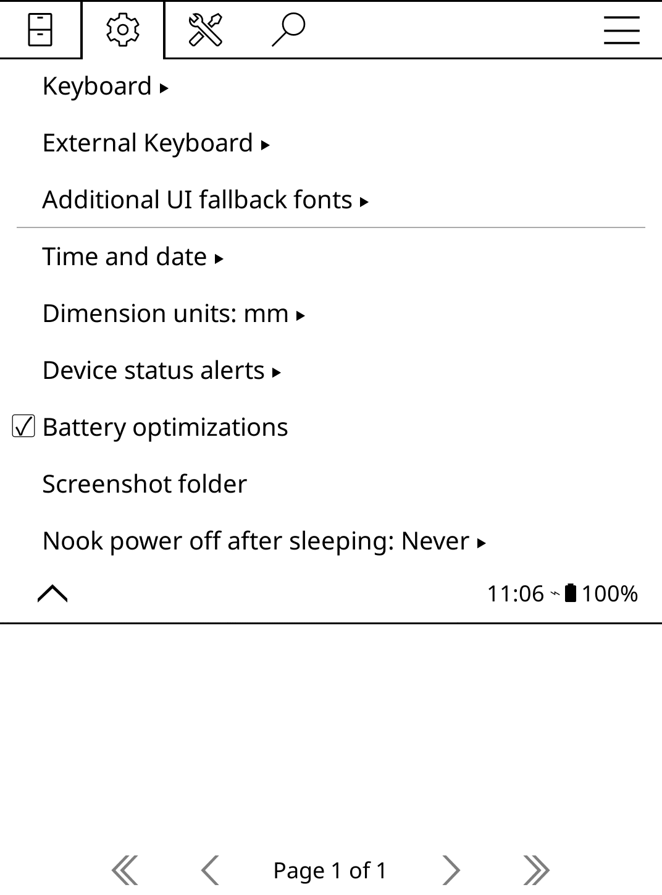

Choose how long the Nook may sleep before it powers off: **Never** (the Nook's normal behaviour), **1 hour**, **6 hours**, **1 day**, **3 days** or **1 week**. **About this setting** explains it on the Nook.

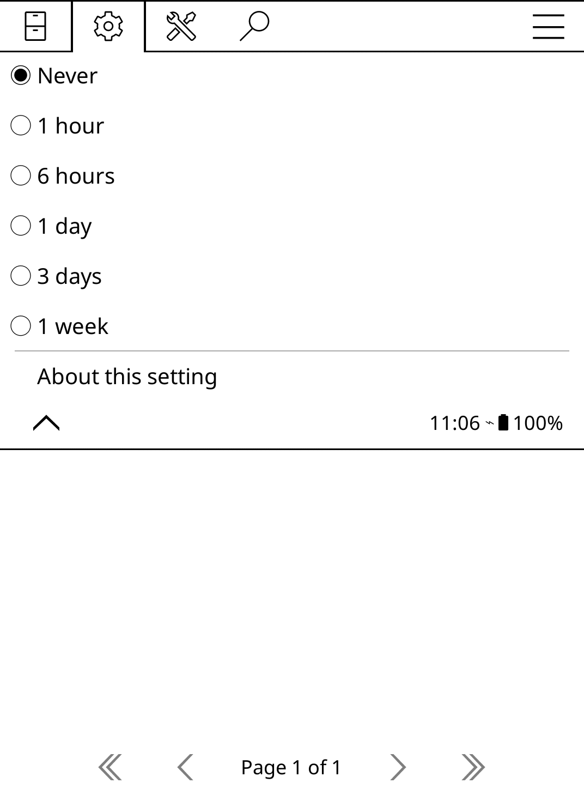

The first time you choose a value, the Nook asks you to allow **Nook Wi-Fi Helper** to "modify system settings" and opens Android's screen for it. Turn the switch on, go back to KOReader, and choose again.

For how long the screen stays on before the Nook sleeps, use KOReader's own **Settings**, **Screen**, **Screen timeout**.

## Open Nook home and the Tools menu

The **Tools** tab has two items added by KOReader-first Nook's installer (on the second page of the tab):

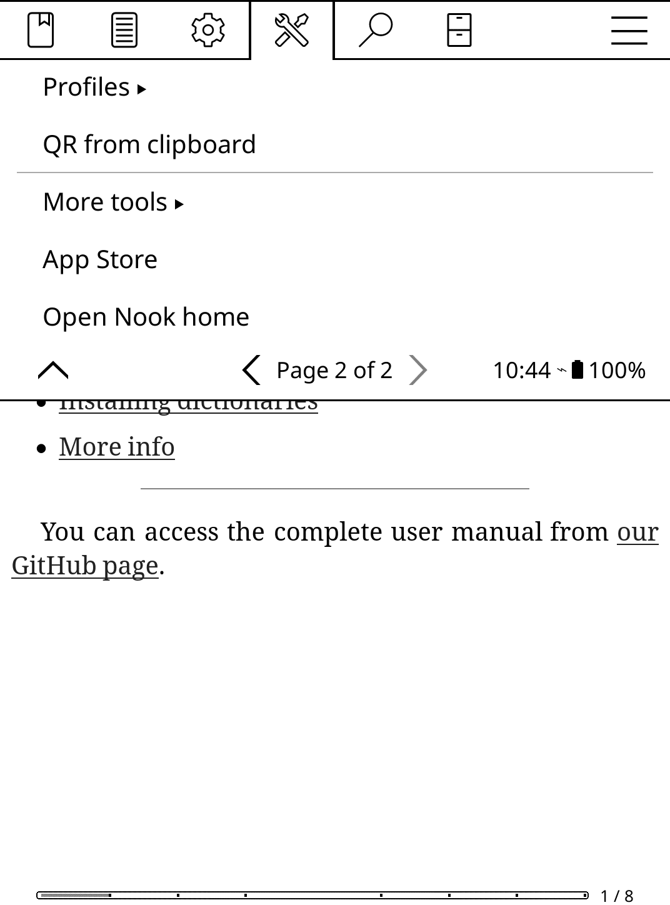

- **Open Nook home**: opens the Nook's own home screen, with your B&N library, the B&N store and the Nook's own settings. Press **Home** to come back to KOReader. Your default Home app does not change. This action can also be put on a gesture or a key.
- **App Store** (if you chose to install it): browse and install plugins and patches made by the KOReader community. It is a separate project with its own support.

If you also chose **ZenFM**, it lets you manage the Nook's files from a web browser on your computer. It is a separate project too; the first time you start it, approve its "Start ZenFM?" prompt.

## Something does not work

**A new setting, font or menu does not show up.**
Use **Restart KOReader** (or Exit, and open KOReader again). KOReader only loads plugins, patches and fonts when it starts.

**Home does not open KOReader.**
Touch the Home button for about a second. If the recovery screen opens instead, choose **Open KOReader and resume Home**.

**Network names show as "(name hidden)", or scanning asks for permission.**
Open **Nook Wi-Fi Helper** from the Nook's app list and tap **Allow location access**. Android only shows network names, and nearby Bluetooth remotes, to apps that have it. The helper never uses your location.

**"Wrong password" for a network you joined before.**
Forget it in **Open Android Wi-Fi settings**, then join it again with **Scan for networks…**

**"Could not connect to X. Connected to Y instead."**
The Nook could not reach X (out of range, or it refused the connection) and went back to another network you have used before.

**A Bluetooth remote does not turn pages.**
Press one of its buttons once to wake it up and let it reconnect, then try again.

**Brightness or warmth do nothing.**
These need KOReader's nightly build (the one the installer provides) and permission for KOReader to change system settings. Running the installer again sets this up.

**"allow Nook Wi-Fi Helper to modify system settings".**
Tap **Open**, turn the switch on, go back to KOReader, and choose again.

**A font is missing from the font list.**
Use **Restart KOReader**. Remember that Lexend is listed as **Lexend-aalt**, and that the list has several pages.

For anything else, including installing, updating and removing KOReader-first Nook, see the README on the project's GitHub page: github.com/apastuszak/nook-koreader-first
